<p align="center">
  
</p>

<p align="center">
  
</p>

<h3 align="center">Science · Technology · Engineering · Maths</h3>

<p align="center">
  <a href="https://nisith-akain.github.io/STEM/"></a>
</p>

Everything regarding science, engineering, maths and technology: notes, cheat sheets and experiments in one place.

## 🧪 Chemistry

| Topic | Read |
| --- | --- |
| Neutralization reactions: acid + base / oxide / carbonate / metal, naming salts, gas tests | [Live page](https://nisith-akain.github.io/STEM/) · [Markdown](chemistry/neutralization-reactions.md) |

## 🗂 Layout

```
STEM/
├── index.html        # GitHub Pages viewer (renders the markdown + LaTeX)
├── banner.svg        # the pixel animation above
├── assets/logo.svg   # the pixel logo
└── chemistry/        # notes by subject
```

New subjects go in their own folder as plain markdown.
